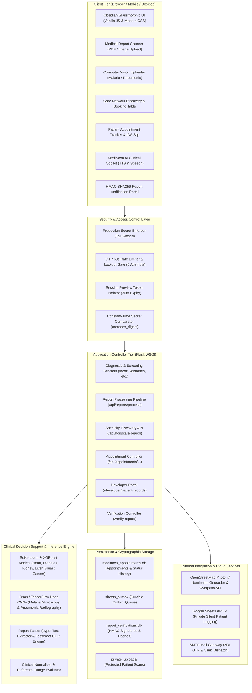
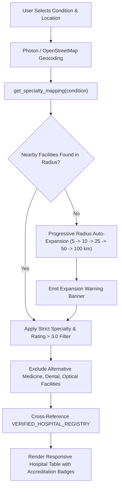
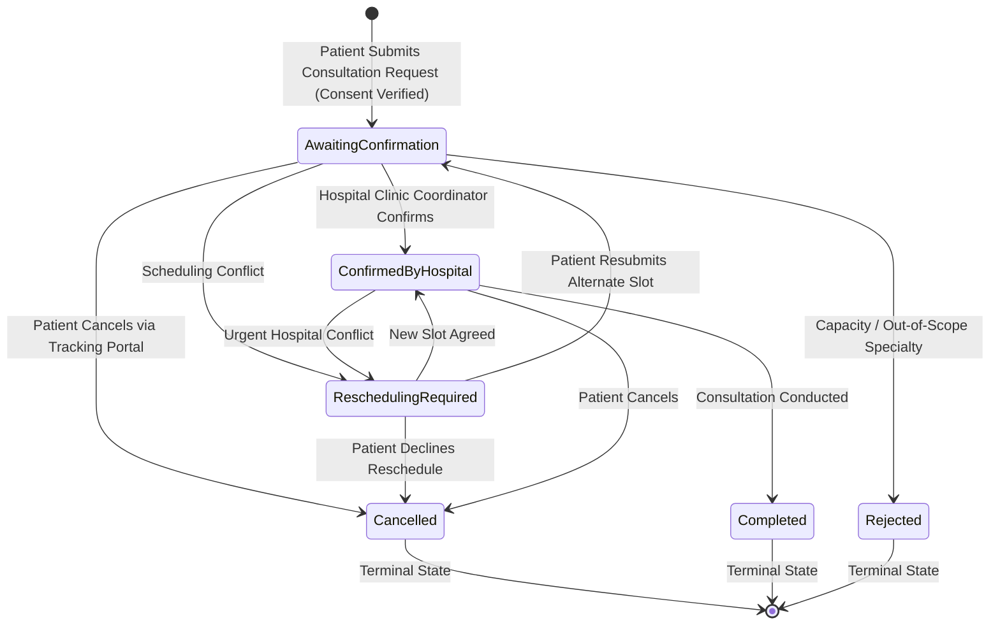
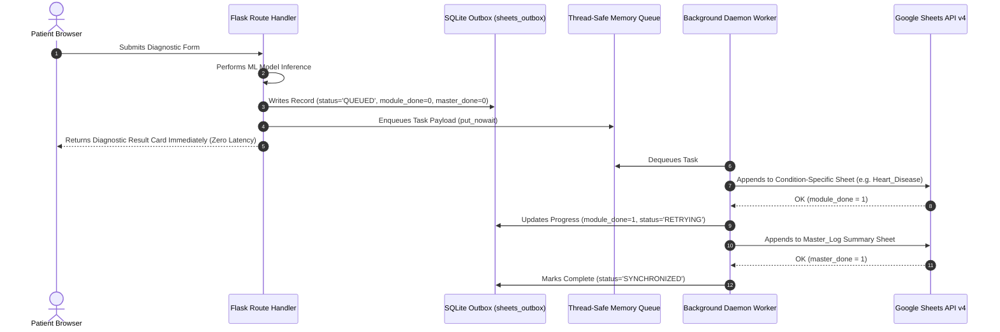
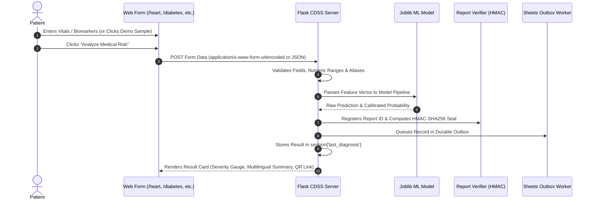
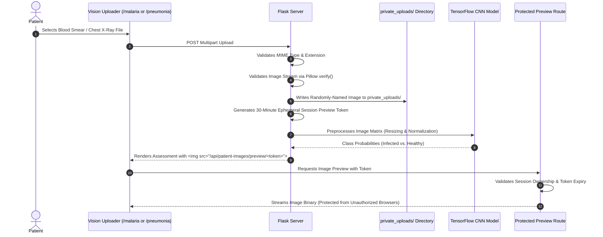
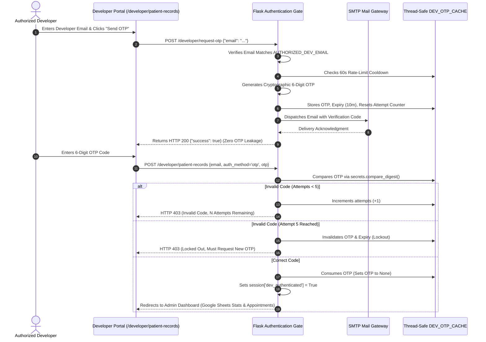

# MediNova System Architecture & End-to-End Workflow Specification

**Version:** 4.2.0 (Post-Audit Enterprise Edition)  
**System Classification:** AI-Powered Healthcare Clinical Decision Support Suite (CDSS)  
**Primary Architect / Maintainer:** DHARSAN KUMAR R  
**Audited & Validated:** October 2026  

---

## 1. Executive Summary & Architectural Overview

**MediNova** is a comprehensive, production-grade clinical decision-support and healthcare discovery web application. It integrates multi-parametric machine learning, deep computer vision, optical character recognition (OCR), geospatial healthcare discovery, priority appointment lifecycle tracking, cryptographic document authentication, and asynchronous cloud record synchronization into a cohesive, dark-themed clinical workstation.

### High-Level System Architecture



---

## 2. Core Functional Subsystems

### 2.1 Diagnostic Screening Suite (7 Clinical Conditions)

The system provides targeted clinical decision support across seven life-threatening and chronic conditions. All models are trained, serialized, and evaluated against standardized medical benchmarks.

| Condition | Primary Modality | ML / DL Architecture | Input Parameters | Output Classification | Probability / Confidence Policy |
| :--- | :--- | :--- | :--- | :--- | :--- |
| **Cardiovascular Disease** | Clinical vitals | Random Forest Classifier (`heart_disease_model.pkl`) | 13 parameters (Age, Sex, Chest Pain, Resting BP, Cholesterol, FBS, EKG, Max HR, Angina, ST Depression, Slope, Vessels, Thallium) | Elevated Cardiac Risk vs. Low Cardiovascular Risk | Calibrated `predict_proba()`; returns `None` if uncalibrated (no fabricated fallbacks) |
| **Diabetes Mellitus** | Metabolic panel | XGBoost Gradient Boosting (`diabetes_model.pkl`) | 8 parameters (Glucose, HbA1c, BMI, Blood Pressure, Insulin, Pregnancies, Age, Pedigree) | Positive Diabetic Marker vs. Negative Metabolic Marker | Calibrated XGBoost probability output |
| **Chronic Kidney Disease (CKD)** | Renal biochemistry | Random Forest Ensemble (`kidney_model.pkl`) | 24 biomarkers (Serum Creatinine, Blood Urea, Albumin, Specific Gravity, Hemoglobin, Potassium, Sodium, etc.) | Renal Dysfunction Detected vs. Healthy Renal Function | Calibrated ensemble probability output |
| **Hepatic Disorders** | Liver function panel | Random Forest Classifier (`liver_model.pkl`) | 10 biomarkers (Total/Direct Bilirubin, ALT, AST, Alkaline Phosphatase, Albumin, Total Protein, A/G Ratio) | Hepatic Risk Detected vs. Normal Hepatic Function | Calibrated ensemble probability output |
| **Breast Cancer** | Morphometry (FNA) | Fine-Needle Aspirate Classifier (`breast_cancer_model.pkl`) | 5 cell nucleus metrics (Mean Radius, Texture, Perimeter, Area, Smoothness) | Malignant Neoplasm Detected vs. Benign Tissue Morphology | Calibrated probability output |
| **Malaria** | Thin blood smear microscopy | Deep Convolutional Neural Network (`malaria_cnn_model_fast.h5`) | $50 \times 50 \times 3$ RGB microphotographs | Parasitized (Infected) vs. Uninfected (Healthy) | Softmax class distribution |
| **Pneumonia** | Chest radiography (CXR) | Deep Convolutional Neural Network (`pneumonia_model_new.h5`) | $150 \times 150 \times 3$ RGB radiograph images | Pulmonary Infiltrates Detected vs. Normal Clear Lung Fields | Sigmoid output activation |

---

### 2.2 Medical Report Scanner & Extraction Engine

The report scanner enables instant triage from existing diagnostic paperwork (PDFs or photos of lab reports):

1. **Format Ingestion:** Accepts PDF documents or image scans (PNG, JPG, JPEG, WebP) up to 16 MB.
2. **Text Extraction:**
   - Digital PDFs are parsed using `pypdf` with stream corruption guards.
   - Scanned documents and images are processed using `pytesseract` OCR with image preprocessing (grayscale, adaptive thresholding).
3. **Biomarker Matching:** Scans the extracted corpus for disease-specific clinical terms, synonyms, and abbreviations (e.g., `"FBS"`, `"Fasting Blood Sugar"`, `"HbA1c"`, `"Serum Creatinine"`, `"SGOT"`, `"ALT"`).
4. **Unit Normalization:** Converts clinical units into canonical model metrics (e.g., converts $\text{mmol/L}$ to $\text{mg/dL}$ for glucose; converts $\text{g/dL}$ to $\text{mg/dL}$ where applicable).
5. **Instant Prediction Mode:** When extraction yields sufficient parameters, the engine automatically invokes the corresponding diagnostic classifier, returning prediction, biomarker gauge positions, and patient summaries in a single HTTP request.

---

### 2.3 Verified Care Network & Disease-Specific Hospital Discovery

MediNova features a location-aware healthcare discovery engine that matches diagnostic findings to verified specialist hospital departments.



#### Specialty Mapping Rules
- **Pneumonia:** Pulmonology, Respiratory Medicine, Chest Medicine, Thoracic Care (*Generic Internal Medicine explicitly disallowed*).
- **Heart Disease:** Cardiology, Interventional Cardiology, Cardiothoracic Surgery (CTVS).
- **Diabetes:** Endocrinology, Diabetology, Diabetes and Metabolism.
- **Kidney Disease:** Nephrology, Renal Medicine, Hemodialysis Services.
- **Liver Disease:** Hepatology, Gastroenterology, Hepatobiliary (HPB) Surgery.
- **Breast Cancer:** Medical Oncology, Surgical Oncology, Breast Cancer Center.
- **Malaria:** Infectious Diseases, Tropical Medicine, Clinical Parasitology.

#### Non-Clinical Exclusion Policy
Strict regex filters discard facilities dedicated exclusively to alternative therapies (Ayurveda, Homeopathy, Unani, Siddha), dentistry, or optometry to ensure patient safety.

---

### 2.4 Priority Appointment Lifecycle State Machine

Consultation requests follow a persistent, auditable state machine stored in `medinova_appointments.db`.



- **Cryptographic Reference ID:** Format `APT-YYYY-XXXXXX` (e.g., `APT-2026-B8E19F`).
- **Patient Isolation:** Tracking queries require both the Reference ID and matching phone or email address.
- **Authoritative Data Binding:** Hospital identifier is cross-referenced with `VERIFIED_HOSPITAL_REGISTRY` to prevent spoofed hospital credentials.

---

### 2.5 Cryptographic Report Integrity & Dynamic QR Codes

Every screening report is sealed with an HMAC-SHA256 signature to guarantee authenticity:

$$\text{Signature} = \text{HMAC-SHA256}_{\text{SECRET}}(\text{Report\_ID} \parallel \text{Module\_Name} \parallel \text{Timestamp})[:24]$$

- **QR Code Endpoint:** `GET /api/report-qr/<report_id>` generates an on-the-fly PNG image encoding the official verification URL.
- **Verification Endpoint:** `GET /verify-report/<report_id>` queries `report_verifications.db`, verifies the cryptographic seal, and displays official assessment metadata, biomarker gauges, and timestamp evidence.

---

### 2.6 Asynchronous Private Logging & Durable Outbox

Patient records are logged asynchronously to private Google Sheets worksheets (`Master_Log` + condition-specific sheet) without degrading diagnostic response latency:



- **Formula Injection Defense:** Non-numeric cell values starting with `=`, `+`, `-`, `@`, `\t`, or `\r` are prepended with a single quote (`'`), neutralizing spreadsheet formula exploits.
- **Idempotency Guarantee:** If the condition-specific append succeeds but the `Master_Log` append fails due to network error, the retry loop skips the condition sheet and only appends to `Master_Log`, completely preventing duplicate rows.
- **Queue Saturation Safety:** If the in-memory queue reaches maximum capacity (`2000` items), the record is preserved in `sheets_outbox` with status `FAILED`/`SATURATED` and processed upon queue clearance.

---

## 3. End-to-End Workflow Specifications

### Workflow 1: Tabular Clinical Screening


### Workflow 2: Medical Image Analysis & Protected Preview


### Workflow 3: Developer 2FA Gateway & Audit Portal


---

## 4. Security & Privacy Framework

| Security Vector | Implementation Mechanism | Assurance & Validation |
| :--- | :--- | :--- |
| **Secrets Management** | Production startup fail-closed checks in `app.py` and `report_verifier.py`. | Raises fatal `RuntimeError` if default keys are detected when `FLASK_ENV=production`. |
| **Credential Masking** | Safe placeholders in `.env.example`. | Zero real API keys, email addresses, or secrets committed to repository. |
| **Protected File Assets** | Excluded in `.gitignore` and `.dockerignore`. | `private_uploads/`, `*.db`, `instance/`, `*.log`, and credentials excluded from builds. |
| **Timing-Attack Resistance** | `secrets.compare_digest()` used for all access keys and OTP verification codes. | Constant-time string execution prevents side-channel timing analysis. |
| **Patient Upload Privacy** | Storage in `private_uploads/` outside public web server roots. | Session-gated ephemeral preview tokens with 30-minute time-to-live. |
| **Image Polyglot Defense** | Pillow `Image.open().verify()` content inspection. | Rejects corrupted files, shell scripts, and HTML polyglots disguised with image extensions. |
| **Spreadsheet Safety** | Prefixing formula trigger characters (`=`, `+`, `-`, `@`, `\t`, `\r`) with single quote. | Neutralizes dynamic DDE and formula injection attacks in exported spreadsheets. |
| **Patient Record Isolation** | Lookup requires Reference ID plus matching patient phone or email. | Prevents sequential reference enumeration and unauthorized record discovery. |

---

## 5. Persistence & Database Schemas

### 5.1 `medinova_appointments.db` — `appointments` Table

```sql
CREATE TABLE appointments (
    id INTEGER PRIMARY KEY AUTOINCREMENT,
    reference_id TEXT UNIQUE NOT NULL,
    access_token TEXT UNIQUE NOT NULL,
    created_at TIMESTAMP DEFAULT CURRENT_TIMESTAMP,
    patient_name TEXT NOT NULL,
    phone TEXT NOT NULL,
    email TEXT NOT NULL,
    condition_id TEXT NOT NULL,
    condition_name TEXT NOT NULL,
    clinical_notes TEXT,
    hospital_id TEXT,
    hospital_name TEXT NOT NULL,
    facility_type TEXT,
    hospital_address TEXT NOT NULL,
    hospital_website TEXT,
    directions_url TEXT,
    distance_km REAL,
    specialty_label TEXT,
    consultation_mode TEXT NOT NULL,
    preferred_date TEXT NOT NULL,
    preferred_time_slot TEXT NOT NULL,
    status TEXT NOT NULL DEFAULT 'Awaiting Hospital Confirmation',
    notification_status TEXT DEFAULT 'Pending',
    is_urgent INTEGER DEFAULT 0,
    consent_given INTEGER NOT NULL DEFAULT 1,
    admin_notes TEXT,
    status_history TEXT NOT NULL
);

CREATE INDEX idx_apt_ref ON appointments(reference_id);
CREATE INDEX idx_apt_email ON appointments(email);
CREATE INDEX idx_apt_phone ON appointments(phone);
CREATE INDEX idx_apt_status ON appointments(status);
```

### 5.2 `medinova_appointments.db` — `sheets_outbox` Table

```sql
CREATE TABLE sheets_outbox (
    id INTEGER PRIMARY KEY AUTOINCREMENT,
    record_id TEXT UNIQUE NOT NULL,
    module_sheet TEXT NOT NULL,
    module_row_json TEXT NOT NULL,
    master_row_json TEXT NOT NULL,
    module_appended INTEGER DEFAULT 0,
    master_appended INTEGER DEFAULT 0,
    status TEXT NOT NULL DEFAULT 'QUEUED',
    retries INTEGER DEFAULT 0,
    last_error TEXT,
    created_at TIMESTAMP DEFAULT CURRENT_TIMESTAMP,
    updated_at TIMESTAMP DEFAULT CURRENT_TIMESTAMP
);

CREATE INDEX idx_outbox_status ON sheets_outbox(status);
CREATE INDEX idx_outbox_rec ON sheets_outbox(record_id);
```

### 5.3 `report_verifications.db` — `report_verifications` Table

```sql
CREATE TABLE report_verifications (
    report_id TEXT PRIMARY KEY,
    created_at TIMESTAMP DEFAULT CURRENT_TIMESTAMP,
    module_name TEXT NOT NULL,
    condition_title TEXT NOT NULL,
    prediction_text TEXT NOT NULL,
    is_positive INTEGER NOT NULL,
    confidence_score REAL,
    is_scanner_extracted INTEGER DEFAULT 0,
    summary_json TEXT,
    verification_hash TEXT NOT NULL
);
```

---

## 6. Automated Testing & Verification Matrix

The test suite covers the complete application stack without relying on live external services (mocked SMTP, geocoding, and Google Sheets APIs):

```bash
python -m unittest discover tests
```

**Execution Result:** `Ran 54 tests in 3.685s — OK (0 failures, 0 errors)`

| Test File | Test Suite Focus | Test Count | Key Invariants Verified |
| :--- | :--- | :---: | :--- |
| [`tests/test_audit_fixes.py`](file:///c:/Users/admin/Desktop/DHARSAN-MediNOVA/tests/test_audit_fixes.py) | Security, Outbox, Privacy & Contracts | **22** | Production fail-closed, OTP non-leakage, 60s rate limit, 5-attempt lockout, private image session tokens, Pillow verify, coordinate bounding boxes, radius limits, state machine transitions, formula injection sanitization, HMAC report signing. |
| [`tests/test_care_network.py`](file:///c:/Users/admin/Desktop/DHARSAN-MediNOVA/tests/test_care_network.py) | Verified Hospital Discovery Engine | **8** | Specialty matching for all 7 diseases, Pulmonology specialty isolation, rating $> 3.0$ filter, progressive expansion (5 to 100 km), authoritative registry cross-referencing. |
| [`tests/test_scanner_pipeline.py`](file:///c:/Users/admin/Desktop/DHARSAN-MediNOVA/tests/test_scanner_pipeline.py) | Report Scanner & OCR Ingestion | **24** | Synthetic PDF extraction, OCR token extraction, unit conversions, biomarker dictionary normalization, instant prediction pipeline. |

---

## 7. Deployment & Operational Runbook

### 7.1 Local Development Setup
1. Clone the repository and activate virtual environment:
   ```bash
   python -m venv venv
   .\venv\Scripts\Activate.ps1
   pip install -r requirements.txt
   ```
2. Copy sample configuration:
   ```bash
   cp .env.example .env
   ```
3. Run the development server:
   ```bash
   python app.py
   ```
   *Access dashboard at `http://127.0.0.1:5000`.*

### 7.2 Production Docker Deployment
1. Build the production container:
   ```bash
   docker build -t medinova-cdss:latest .
   ```
2. Run with production environment variables:
   ```bash
   docker run -d -p 5000:5000 \
     -e FLASK_ENV=production \
     -e SECRET_KEY="<strong-random-hex-key>" \
     -e DEV_ACCESS_KEY="<strong-random-access-key>" \
     -e REPORT_SIGNING_SECRET="<strong-random-signing-secret>" \
     -e AUTHORIZED_DEV_EMAIL="dharshankumarkumar3@gmail.com" \
     -e SMTP_USERNAME="<smtp-user>" \
     -e SMTP_PASSWORD="<smtp-app-password>" \
     medinova-cdss:latest
   ```

---

## 8. Clinical Advisory & Compliance Note

1. **Intended Use:** MediNova is an algorithmic clinical decision-support and risk-stratification system designed for triage and healthcare referral discovery. It is not an automated diagnostic device and does not replace medical diagnosis by a registered physician.
2. **Confidence Reporting:** When statistical confidence cannot be calibrated with validated clinical probability methods, the system explicitly reports *"Not Stated (Categorical Assessment)"* and records `confidence_score = None`.
3. **Emergency Escalation:** Any patient input matching critical red-flag terms triggers emergency dispatch banners and immediate hotline referral buttons (`112 / 911 / 108`).
