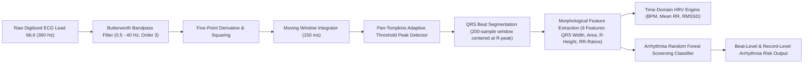
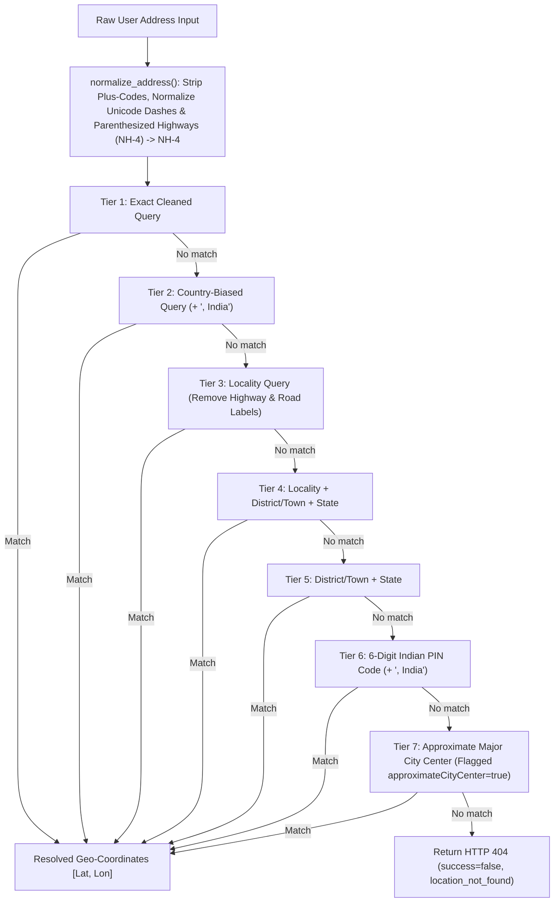
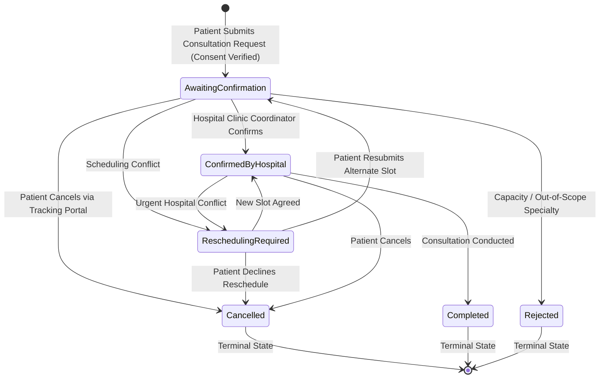
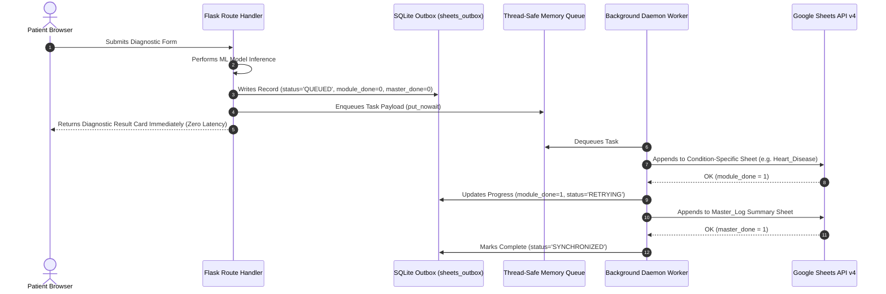

# MediNova System Architecture & End-to-End Workflow Specification

**Version:** 5.0.0 (Next-Generation Multimodal Clinical Decision Support Edition)  
**System Classification:** AI-Powered Multimodal Healthcare Clinical Decision Support Suite (CDSS) & Biosignal Screening Workstation  
**Primary Architect / Maintainer:** DHARSAN KUMAR R  
**Audited & Validated:** October 2026  

---

## 1. Executive Summary & Architectural Overview

**MediNova** is a modular, resource-aware, secure clinical decision-support and preliminary screening platform. It integrates multi-parametric machine learning, deep convolutional neural networks, digital biosignal processing (ECG), optical character recognition (OCR), geospatial healthcare discovery, priority consultation lifecycle tracking, cryptographic document authentication, and asynchronous durable audit logging into a unified clinical workstation.

Designed for resource-constrained clinical edge deployments (e.g., cloud containers with $\le 512\,\text{MB}$ RAM limits), MediNova strictly enforces lazy model loading, out-of-distribution (OOD) biomarker validation envelopes, session-bound CSRF protection, and defense-in-depth HTTP security headers.

> 📋 **Operational Workflows & Sequence Specifications:**  
> For complete step-by-step sequence diagrams, patient triage flows, and state machines, see [WORKFLOW.md](WORKFLOW.md).

### High-Level System Architecture

```mermaid
flowchart TB
    subgraph ClientTier ["Client Tier (Clinical Workstation / Browser)"]
        UI["Obsidian Clinical Workstation UI (Vanilla JS & Modern CSS)"]
        ScannerUI["Medical Report Scanner (PDF / Image OCR Ingestion)"]
        VisionUI["Deep Learning Uploader (Malaria Microscopy / Pneumonia CXR)"]
        ECGUI["Biosignal Telemetry Workstation (MIT-BIH Waveform Canvas)"]
        ThyroidUI["Endocrine Panel Workstation (8 Analyte Biomarker Gauges)"]
        HospitalUI["Care Network Discovery & Specialist Booking Table"]
        ActiveOriginMgr["Centralized ACTIVE_ORIGIN State Machine (contact.html)"]
        TrackerUI["Patient Appointment Tracker & ICS Slip"]
        VerifyUI["HMAC-SHA256 Report Verification Portal"]
    end

    subgraph SecurityGateway ["Security & Access Control Layer"]
        CSRFGuard["Session-Bound CSRF Protection (secrets.compare_digest)"]
        SecHeaders["Defense-in-Depth Headers (CSP, X-Frame-Options: DENY, nosniff)"]
        FailClosed["Production Secret Enforcer (Fail-Closed Default Keys)"]
        RateLimiter["OTP 60s Rate Limiter & Lockout Gate (5 Attempts)"]
        SessionGating["Session Preview Token Isolator (30m Ephemeral Expiry)"]
        PrivateStorageGate["Private Upload Storage Isolator (private_uploads/)"]
    end

    subgraph AppTier ["Application Controller Tier (Flask WSGI)"]
        Routes["Clinical Screening Routes (/heart, /diabetes, /thyroid, /arrhythmia, etc.)"]
        RoadmapGate["Governed Roadmap Gate (403 Forbidden for Inactive Candidates)"]
        ScanAPI["Report Processing Pipeline (/api/reports/process)"]
        GeocodeProxyAPI["Progressive Geocoder Proxy (/api/hospitals/geocode)"]
        HospAPI["Specialty Discovery API (/api/hospitals/search)"]
        AptAPI["Appointment Controller (/api/appointments/...)"]
        DevAPI["Developer Portal (/developer/patient-records)"]
        TelemetryAPI["Operational Telemetry API (/api/monitoring, /api/catalog)"]
        VerifyAPI["Verification Controller (/verify-report/<id>)"]
    end

    subgraph MLTier ["Unified Inference & Clinical Governance Engine"]
        InferenceService["Unified CDSS Inference Dispatcher (utils/inference_service.py)"]
        ModelRegistry["Master Manifest & Lazy Model Loader (models/model_registry.json)"]
        ValidationGateway["Physiological Plausibility & OOD Envelope (utils/clinical_validation.py)"]
        SignalProcessor["Digital Biosignal Engine (Pan-Tompkins & Butterworth Filter)"]
        TabularModels["Calibrated Scikit-Learn / XGBoost Models (Heart, Diabetes, Kidney, Liver, Cancer, Thyroid)"]
        SignalModel["PhysioNet MIT-BIH Arrhythmia Random Forest Classifier"]
        VisionCNN["Keras / TensorFlow Deep CNNs (Lazy Loaded: Malaria & Pneumonia)"]
        ScannerPipeline["Report Parser (pypdf Text Extractor & Tesseract OCR Engine)"]
    end

    subgraph DataTier ["Persistence & Cryptographic Storage"]
        SQLiteApt["medinova_appointments.db (Appointments & Status History)"]
        SQLiteOutbox["sheets_outbox (Durable Outbox Queue)"]
        SQLiteVerify["report_verifications.db (HMAC Signatures & Hashes)"]
        PrivateStorage["private_uploads/ (Protected Patient Scans)"]
    end

    subgraph ExternalTier ["External Integration & Cloud Services"]
        OSM["OpenStreetMap Photon / Nominatim Geocoder & Overpass API"]
        GMapsRouting["Google Maps Dynamic Directions (Coordinate-First Routing)"]
        GSheets["Google Sheets API v4 (Private Asynchronous Patient Logging)"]
        SMTPService["SMTP Mail Gateway (2FA OTP & Clinic Dispatch)"]
    end

    ClientTier --> SecurityGateway
    SecurityGateway --> AppTier
    AppTier --> MLTier
    AppTier --> DataTier
    AppTier --> ExternalTier
```



---

## 2. Core Functional Subsystems

### 2.1 Diagnostic Screening Suite (9 Active Clinical Modules)

MediNova provides evidence-based clinical decision support across nine validated conditions. Every active model is registered in `models/model_registry.json` with an immutable SHA-256 artifact checksum, verified input schema, and empirical evaluation metrics.

| Condition | URL Route | Primary Modality | ML / DL Architecture | Input Parameters | Output Classification | Probability / Calibration Policy |
| :--- | :--- | :--- | :--- | :--- | :--- | :--- |
| **Cardiovascular Disease** | `/heart` | Clinical vitals | Random Forest Classifier (`heart_disease_model.pkl`) | 13 parameters (Age, Sex, Chest Pain, Resting BP, Cholesterol, FBS, EKG, Max HR, Angina, ST Depression, Slope, Vessels, Thallium) | Elevated Cardiac Risk vs. Low Cardiovascular Risk | Calibrated `predict_proba()`; returns `None` if uncalibrated (no fabricated fallbacks) |
| **Diabetes Mellitus** | `/diabetes` | Metabolic panel | XGBoost Gradient Boosting (`diabetes_model.pkl`) | 8 parameters (Glucose, HbA1c, BMI, Blood Pressure, Insulin, Pregnancies, Age, Pedigree) | Positive Diabetic Marker vs. Negative Metabolic Marker | Calibrated XGBoost probability output |
| **Chronic Kidney Disease (CKD)** | `/kidney` | Renal biochemistry | Random Forest Ensemble (`kidney_model.pkl`) | 24 biomarkers (Serum Creatinine, Blood Urea, Albumin, Specific Gravity, Hemoglobin, Potassium, Sodium, etc.) | Renal Dysfunction Detected vs. Healthy Renal Function | Calibrated ensemble probability output |
| **Hepatic Disorders** | `/liver` | Liver function panel | Random Forest Classifier (`liver_model.pkl`) | 10 biomarkers (Total/Direct Bilirubin, ALT, AST, Alkaline Phosphatase, Albumin, Total Protein, A/G Ratio) | Hepatic Risk Detected vs. Normal Hepatic Function | Calibrated ensemble probability output |
| **Breast Cancer** | `/breast_cancer` | Morphometry (FNA) | Fine-Needle Aspirate Classifier (`breast_cancer_model.pkl`) | 5 cell nucleus metrics (Mean Radius, Texture, Perimeter, Area, Smoothness) | Malignant Neoplasm Detected vs. Benign Tissue Morphology | Calibrated probability output |
| **Thyroid Dysfunction** *(New)* | `/thyroid` | Endocrine panel | Calibrated Random Forest Pipeline (`thyroid_model.pkl`) | 8 parameters (Age, Sex, On Thyroxine, TSH, T3, TT4, T4U, FTI) | Thyroid Dysfunction (Hypothyroid) vs. Euthyroid (Normal Function) | Calibrated Sigmoid Probabilities (Brier Score: 0.0024); Test Sens: 100%, Spec: 99.78% |
| **Cardiac Arrhythmia** *(New)* | `/arrhythmia` | Biosignal (ECG Lead MLII) | Biosignal Feature Ensemble (`ecg_arrhythmia_model.pkl`) | 360 Hz digitized ECG waveform (Butterworth filtered, Pan-Tompkins QRS, 9 morphological features) | Arrhythmic Ectopy (PVC/Ectopic Beat) vs. Normal Sinus Rhythm | Empirical Risk Assessment (calibrated threshold 0.20; Test Sens: 97.78%, Spec: 100%) |
| **Malaria Parasitemia** | `/malaria` | Thin blood smear microscopy | Deep Convolutional Neural Network (`malaria_cnn_model_fast.h5`) | $50 \times 50 \times 3$ RGB microphotographs | Parasitized (Infected) vs. Uninfected (Healthy) | Softmax class distribution (Lazy loaded on request) |
| **Pulmonary Infiltration (Pneumonia)** | `/pneumonia` | Chest radiography (CXR) | Deep Convolutional Neural Network (`pneumonia_model_new.h5`) | $150 \times 150 \times 3$ RGB radiograph images | Pulmonary Infiltrates Detected vs. Normal Clear Lung Fields | Sigmoid output activation (Lazy loaded on request) |

---

### 2.2 Governed Clinical Research Roadmap (4 Inactive Candidates)

In strict accordance with clinical AI governance standards, conditions lacking validated local artifacts, approved patient cohorts, or verified clinical trials are cataloged as **Research Previews** in `models/model_registry.json`.

```
                        +---------------------------------------+
                        |  Clinical Research Roadmap Candidates |
                        +---------------------------------------+
                                           |
         +-----------------+---------------+---------------+-----------------+
         |                 |                               |                 |
         v                 v                               v                 v
+------------------+ +------------------+     +------------------+ +------------------+
|    Diabetic      | |     Melanoma     |     |   Tuberculosis   | |      Anemia      |
|  Retinopathy     | |  Classification  |     |  Screening (CXR) | | Screening (CBC)  |
|  Status: PREVIEW | |  Status: PREVIEW |     |  Status: PREVIEW | |  Status: PREVIEW |
|  Target: EyePACS | |  Target: ISIC    |     |  Target: NIH-CXR | |  Target: CBC Ref |
+------------------+ +------------------+     +------------------+ +------------------+
         |                 |                               |                 |
         +-----------------+---------------+---------------+-----------------+
                                           |
                                           v
                        +---------------------------------------+
                        |    Inference Request Interceptor     |
                        |      (HTTP 403 Access Forbidden)      |
                        +---------------------------------------+
```

1. **Diabetic Retinopathy Screening (`diabetic_retinopathy`):** Candidate modality: Color retinal fundus photography. Target dataset: EyePACS / Messidor-2. Gated pending approved patient consent and clinical ophthalmology review.
2. **Cutaneous Melanoma Classification (`melanoma`):** Candidate modality: Dermoscopic lesion imaging. Target dataset: ISIC Archive (International Skin Imaging Collaboration). Gated pending segmentation quality metrics and dermatopathologist concordance review.
3. **Pulmonary Tuberculosis Triage (`tuberculosis`):** Candidate modality: Posteroanterior chest radiography. Target dataset: Shenzhen / Montgomery County cohorts. Gated pending microbiological culture cross-referencing.
4. **Anemia Screening (`anemia`):** Candidate modality: Complete Blood Count (CBC) hematological panel (Hb, RBC, MCV, MCH, MCHC, RDW, Ferritin). Gated pending clinical laboratory validation.

**Security & Governance Enforcement:** Any direct POST or GET request targeting roadmap candidate routes returns an explicit `HTTP 403 Forbidden` response with a structured payload:
```json
{
  "status": "research_preview",
  "active": false,
  "condition_id": "diabetic_retinopathy",
  "message": "Clinical screening model for diabetic_retinopathy is currently in research preview and not activated for patient inference."
}
```
*Zero synthetic or simulated predictions are ever returned for unactivated modules.*

---

### 2.3 Model Registry, Artifact Integrity & Lazy Loading

Model management is decoupled from route execution via `utils/model_registry.py` and governed by `models/model_registry.json`.

#### Immutable SHA-256 Manifest
Every active model file on disk must match its registered SHA-256 digest:

| Model ID | Artifact Path | SHA-256 Checksum Digest |
| :--- | :--- | :--- |
| `heart` | `models/heart_disease_model.pkl` | `d60d3d3ef711b667fd0b031f0cf871ea009e355c3c0b05b6a71e62a1491cf1ae` |
| `diabetes` | `models/diabetes_model.pkl` | `542a2e6fca718b53e839e55716df6d38fa2c039b5fa0b9435b678280655db741` |
| `kidney` | `models/kidney_model.pkl` | `62bfa122c608f0ef6dd6bc7fe6207fe7c2607faeb3fa1538fc6cfc2dbd523611` |
| `liver` | `models/liver_model.pkl` | `6745168ba609f302b1ff5801ba90c6ca7e00fb3033e9d892419a4e4d6d62a74c` |
| `breast_cancer`| `models/breast_cancer_model.pkl` | `6862804b4081c70e0600bc45cc2817d23d724bc2799347d8e8b671a5cc6dffc4` |
| `thyroid` | `models/thyroid_model.pkl` | `a4a528b07092aca8f908b58e7e7fc7952b48646e5321d4d46343830f953b275f` |
| `arrhythmia` | `models/ecg_arrhythmia_model.pkl` | `8e9ed74991faf3c4621950e2e370fe7db8ee883f67d4cbad088b7465d0d1d99c` |
| `malaria` | `models/malaria_cnn_model_fast.h5` | `e9c1b3f9ff17e923e3e29f3796f60a927fa1a4e1017efad8b4aa03be16a13317` |
| `pneumonia` | `models/pneumonia_model_new.h5` | `eb1b4bb18bfa632ba5f899e1d88a291f9b319525fc9695d72c1c68e1ee5ff131` |

#### Resource-Aware Lazy Loading Policy
To guarantee stability within a 512 MB memory boundary:
1. Lightweight tabular models ($\le 5\,\text{MB}$) and signal feature ensembles are cached on first access.
2. Heavyweight TensorFlow / Keras deep neural networks (`pneumonia_model_new.h5` $\approx 58\,\text{MB}$ in storage, $> 220\,\text{MB}$ uncompressed RAM graph footprint) are loaded **lazily on demand** and isolated through thread locks.
3. System telemetry (`/api/monitoring`) tracks process RSS memory usage and per-condition inference latencies.

---

### 2.4 Digital Biosignal Processing & Arrhythmia Analysis Engine

The ECG screening pipeline (`utils/signal_processor.py`) processes digital 1-lead telemetry without reliance on opaque image heuristics:



#### Feature Extraction Schema
For each segmented QRS complex:
1. `pre_rr`: Preceding R-R interval ($t_{R_i} - t_{R_{i-1}}$) in seconds.
2. `post_rr`: Succeeding R-R interval ($t_{R_{i+1}} - t_{R_i}$) in seconds.
3. `local_rr`: Ratio of current R-R interval to 10-beat local running average.
4. `qrs_width`: QRS duration from Q-onset to S-offset in seconds.
5. `r_peak_val`: Amplitude of R-peak in normalized millivolts ($\text{mV}$).
6. `qrs_area`: Integrated area under the rectified QRS waveform.
7. `qrs_energy`: Sum of squared sample amplitudes within the QRS window.
8. `p_wave_present`: Binary flag indicating P-wave deflection in the pre-QRS PR window ($120 - 200\,\text{ms}$).
9. `st_level`: Mean elevation or depression in the ST segment ($80\,\text{ms}$ post J-point).

#### Clinical Validation Results (PhysioNet MIT-BIH Arrhythmia Database)
- **Patient-Level Split Strategy:** Evaluated with strict patient separation (Patient 119 for training; Patients 100 & 200 for independent evaluation) to prevent inter-patient morphology leakage.
- **Untouched Test Cohort:** 288 independent beats (243 Normal Sinus beats, 45 Arrhythmic PVC beats).
- **Test Metrics:**
  - **Accuracy:** $99.65\%$
  - **Sensitivity (Recall for Arrhythmia):** $97.78\%$ ($44 / 45$ ectopic events identified)
  - **Specificity:** $100.0\%$ ($243 / 243$ normal beats correctly categorized)
  - **Precision (Positive Predictive Value):** $100.0\%$
  - **F1-Score:** $0.9888$
  - **ROC-AUC:** $0.9887$ at the validated screening threshold of $0.20$.

---

### 2.5 Endocrine Panel & Thyroid Screening Engine

The thyroid screening module (`training/train_thyroid.py` and `utils/diagnostic_predictor.py`) evaluates 8 serum analytes using an imputer-classifier pipeline:

$$\text{Pipeline} = \text{SimpleImputer}(\text{strategy}=\text{'median'}) \longrightarrow \text{CalibratedClassifierCV}(\text{RandomForestClassifier}, \text{method}=\text{'sigmoid'}, \text{cv}=5)$$

#### Clinical Validation Results (Garavan Institute / UCI Thyroid Disease)
- **Dataset Cohort:** 2,800 training records, 972 untouched test patient records (`allhypo.test`).
- **Target Definition:** Primary / Secondary Hypothyroidism vs. Euthyroid.
- **Untouched Test Cohort Results:**
  - **Accuracy:** $99.79\%$
  - **Sensitivity (Recall):** $100.0\%$ ($71 / 71$ hypothyroid patients detected)
  - **Specificity:** $99.78\%$ ($899 / 901$ euthyroid patients verified)
  - **Precision:** $97.26\%$
  - **F1-Score:** $0.9861$
  - **ROC-AUC:** $0.9997$
  - **Brier Score (Probability Calibration):** $0.0024$ (indicating superior probability reliability)

---

### 2.6 Medical Report Scanner & Extraction Engine

The report scanner enables triage from diagnostic paperwork (PDFs or photos of lab reports):

1. **Format Ingestion:** Accepts PDF documents or image scans (PNG, JPG, JPEG, WebP) up to 16 MB.
2. **Text Extraction:**
   - Digital PDFs are parsed using `pypdf` with stream corruption guards.
   - Scanned documents and images are processed using `pytesseract` OCR with grayscale and adaptive threshold preprocessing.
3. **Biomarker Matching:** Scans the extracted text for disease-specific clinical terms, synonyms, and abbreviations across all supported modules (e.g., `"TSH"`, `"Free T4"`, `"FBS"`, `"HbA1c"`, `"Serum Creatinine"`, `"SGOT"`, `"ALT"`).
4. **Unit Normalization:** Converts clinical units into canonical model metrics (e.g., converts $\text{mmol/L}$ to $\text{mg/dL}$ for glucose; converts $\text{g/dL}$ to $\text{mg/dL}$ where applicable).
5. **Instant Prediction Mode:** When extraction yields sufficient parameters, the engine automatically invokes the corresponding diagnostic classifier, returning prediction, biomarker gauge positions, and patient summaries in a single HTTP request.

---

### 2.7 Verified Care Network & Geospatial Hospital Discovery Engine

MediNova features a location-aware, privacy-preserving healthcare discovery engine that matches clinical findings to verified hospital departments, calculates straight-line distances from the patient's active coordinates, and generates coordinate-first Google Maps navigation routes.

#### 2.7.1 Progressive 7-Tier Query Decomposition Pipeline
Real-world patient location inputs—particularly within the Indian healthcare context—frequently contain composite addresses with highway designations (e.g., `(NH-4)`), educational campus landmarks, taluk names, and district boundaries (e.g., `"Saveetha Engineering College, Saveetha Nagar, (NH-4), Sriperumbudur Taluk, Kanchipuram District, Chennai, Tamil Nadu, 602105"`). Standard single-query geocoders fail to resolve such compound strings.

MediNova implements a progressive 7-tier candidate decomposition engine in `utils/hospital_service.py` (`normalize_address()` and `generate_progressive_candidates()`):



1. **Tier 1 (Exact Cleaned Query):** Preprocessed string with duplicate commas, excess whitespace, and plus-codes removed.
2. **Tier 2 (Country-Biased Query):** Appends `", India"` to anchor ambiguous domestic town names.
3. **Tier 3 (Locality Without Road Noise):** Strips road noise tokens (`NH-4`, `Expressway`, `Bypass`, `Main Road`, `Lane`, `Street`, `Plot No`, `Door No`) to isolate landmark and sub-locality tokens.
4. **Tier 4 (Locality + District/Town + State):** Composite token combining the neighborhood with its administrative district and state.
5. **Tier 5 (District/Town + State):** Fallback to administrative taluk / district boundary.
6. **Tier 6 (6-Digit Indian PIN Code):** Extracts `\b[1-9][0-9]{5}\b` pattern to resolve the postal delivery centroid.
7. **Tier 7 (Approximate City Center):** Resolves major urban metropolitan center only when explicitly contained within the input. **Crucial Governance Invariant:** If Tier 7 is utilized, the payload explicitly returns `"approximateCityCenter": true` and `"resolutionLevel": "city_approximate"`. It is never silently substituted as an exact patient location.

#### 2.7.2 Multi-Provider Geocoding Architecture
Direct browser calls to external geocoding endpoints are blocked by CORS policies and forbidden User-Agent header restrictions. MediNova routes all geocoding through a server-side proxy endpoint:

$$\text{POST } \texttt{/api/hospitals/geocode} \longrightarrow \texttt{resolve\_any\_address(address)}$$

The resolver queries OpenStreetMap Nominatim with strict HTTP compliance (`User-Agent: MediNova-Clinical-App/5.0.0`, `timeout=6.0s`) and automatically falls back to the Komoot Photon API (`timeout=5.0s`, SSL verified) if Nominatim encounters rate limits or connection failures.

#### 2.7.3 Centralized `ACTIVE_ORIGIN` State Architecture
To eliminate race conditions across multiple origin input methods (manual text search, browser GPS geolocation, and quick metro city selector buttons), `templates/contact.html` maintains a single centralized client-side state machine:

```javascript
let ACTIVE_ORIGIN = {
    userOriginCoords: null,            // [lat, lng] or null
    userOriginAddress: '',             // Raw input or metro label
    userOriginResolvedAddress: '',     // Canonical geocoded address string
    userOriginSource: 'none',          // 'browser_geolocation' | 'address_search' | 'metro_quick_button' | 'approximate_city_center'
    userOriginPrecision: 'unresolved'  // 'gps_exact' | 'geocoded_high' | 'geocoded_locality' | 'geocoded_pincode' | 'city_approximate'
};
```

**State Synchronization Invariants:**
- Every origin update (manual search, browser GPS, or quick metro click) writes directly to `ACTIVE_ORIGIN` before hospital filtering begins.
- Quick Metro buttons (Chennai, Delhi, Mumbai, Bengaluru, Hyderabad, Kolkata) populate the address input text box and update `ACTIVE_ORIGIN` with verified metropolitan coordinates.
- Browser GPS invokes `navigator.geolocation.getCurrentPosition` with `enableHighAccuracy: true`, sets `userOriginSource = 'browser_geolocation'`, and sets `userOriginPrecision = 'gps_exact'`.
- Failed searches invoke `clearActiveOrigin()`, resetting `ACTIVE_ORIGIN` to initial null values and immediately emptying `ALL_RECOMMENDATIONS = []`.

#### 2.7.4 Straight-Line Haversine Distance & Coordinate-First Navigation Model
All hospital distances are computed strictly via the Haversine formula on spherical coordinates:

$$d = 2R \arcsin \left( \sqrt{ \sin^2\left(\frac{\Delta \phi}{2}\right) + \cos(\phi_1)\cos(\phi_2)\sin^2\left(\frac{\Delta \lambda}{2}\right) } \right)$$

where $R = 6371.0\,\text{km}$, $\phi$ is latitude in radians, and $\lambda$ is longitude in radians.

**Dynamic Coordinate-First Google Maps Navigation URLs:**  
To prevent text-based location ambiguity and incorrect route origins, MediNova generates Google Maps directions URLs using strict coordinate pairs:

$$\texttt{https://www.google.com/maps/dir/?api=1\&origin=}\mathbf{LAT}\%2C\mathbf{LNG}\texttt{\&destination=}\mathbf{DEST}\texttt{\&travelmode=driving}$$

If `ACTIVE_ORIGIN.userOriginCoords` is available (e.g. `13.0265, 80.0159`), the origin parameter is formatted as `13.026500%2C80.015900`. If coordinates are unavailable, the system safely falls back to URI-encoded textual address strings.

#### 2.7.5 Specialty Mapping & Anti-General Medicine Clinical Governance
MediNova strictly enforces condition-to-department specialization. Patients screening positive for serious organ-specific pathologies must not be directed to general outpatient departments:

| Condition | Verified Clinical Departments Required | Disallowed Departments |
| :--- | :--- | :--- |
| **Pneumonia** | Pulmonology, Respiratory Medicine, Chest Medicine, Thoracic Care | *Internal Medicine, General Medicine, OPD* |
| **Heart Disease** | Cardiology, Interventional Cardiology, Cardiothoracic Surgery (CTVS) | *General Practice, Family Medicine* |
| **Diabetes** | Endocrinology, Diabetology, Diabetes and Metabolism | *General Medicine* |
| **Kidney Disease** | Nephrology, Renal Medicine, Hemodialysis Services | *General Surgery* |
| **Liver Disease** | Hepatology, Gastroenterology, Hepatobiliary (HPB) Surgery | *General Medicine* |
| **Breast Cancer** | Medical Oncology, Surgical Oncology, Breast Cancer Center | *General Gynecology* |
| **Thyroid Dysfunction**| Endocrinology, Endocrine Surgery, Thyroid Center | *General Medicine* |
| **Cardiac Arrhythmia**| Cardiac Electrophysiology, Arrhythmia & Pacemaker Clinic, Cardiology | *General Practice* |
| **Malaria** | Infectious Diseases, Tropical Medicine, Clinical Parasitology | *Alternative Medicine* |

#### 2.7.6 Non-Clinical Exclusion Policies
Strict regex filters automatically discard facilities dedicated exclusively to alternative therapies (Ayurveda, Homeopathy, Unani, Siddha), standalone dental clinics, and optical shops to safeguard patients facing acute or specialized conditions. Furthermore, any facility with an aggregated patient rating $\le 3.0$ is filtered out.

#### 2.7.7 Progressive Radius Auto-Expansion
When no verified specialist hospital is found within the user-selected radius (e.g., 5 km), the search auto-expands progressively:

$$5\,\text{km} \longrightarrow 15\,\text{km} \longrightarrow 30\,\text{km} \longrightarrow 50\,\text{km} \longrightarrow 100\,\text{km}$$

The UI explicitly displays an informative banner informing the patient of the expanded search radius and the nearest verified facility distance.

#### 2.7.8 Fail-Safe State Synchronization & Anti-Stale Data Flushing
When address resolution fails or a non-existent location is queried:
1. `clearActiveOrigin()` is triggered immediately.
2. The active origin coordinates, query strings, and precision tokens are purged from memory.
3. The recommendation cache is completely emptied: `ALL_RECOMMENDATIONS = []`.
4. The DOM hospital table is cleared and replaced with a clean *"Location Not Found"* advisory banner.
5. Stale distance estimates from previous searches are never permitted to persist in the user interface.

---

### 2.8 Priority Appointment Lifecycle State Machine

Consultation requests follow a persistent, auditable state machine stored in `medinova_appointments.db`.



- **Cryptographic Reference ID:** Format `APT-YYYY-XXXXXX` (e.g., `APT-2026-B8E19F`).
- **Patient Isolation:** Tracking queries require both the Reference ID and matching phone or email address.
- **Authoritative Data Binding:** Hospital identifier is cross-referenced with `VERIFIED_HOSPITAL_REGISTRY` to prevent spoofed hospital credentials.

---

### 2.9 Cryptographic Report Integrity & Dynamic QR Codes

Every screening report is sealed with an HMAC-SHA256 signature to guarantee authenticity:

$$\text{Signature} = \text{HMAC-SHA256}_{\text{SECRET}}(\text{Report\_ID} \parallel \text{Module\_Name} \parallel \text{Timestamp})[:24]$$

- **QR Code Endpoint:** `GET /api/report-qr/<report_id>` generates an on-the-fly PNG image encoding the official verification URL.
- **Verification Endpoint:** `GET /verify-report/<report_id>` queries `report_verifications.db`, verifies the cryptographic seal, and displays official assessment metadata, biomarker gauges, and timestamp evidence.

---

### 2.10 Asynchronous Private Logging & Durable Outbox

Patient records are logged asynchronously to private Google Sheets worksheets (`Master_Log` + condition-specific sheet) without degrading diagnostic response latency:



- **Formula Injection Defense:** Non-numeric cell values starting with `=`, `+`, `-`, `@`, `\t`, or `\r` are prepended with a single quote (`'`), neutralizing spreadsheet formula exploits.
- **Idempotency Guarantee:** If the condition-specific append succeeds but the `Master_Log` append fails due to network error, the retry loop skips the condition sheet and only appends to `Master_Log`, completely preventing duplicate rows.
- **Queue Saturation Safety:** If the in-memory queue reaches maximum capacity (`2000` items), the record is preserved in `sheets_outbox` with status `FAILED`/`SATURATED` and processed upon queue clearance.

---

## 3. Strict Security & Clinical Privacy Hardening

| Security Vector | Implementation Mechanism | Assurance & Validation |
| :--- | :--- | :--- |
| **CSRF Defense** | Session-bound cryptographically random token injected into Jinja contexts and verified on all state-changing POST requests using `secrets.compare_digest()`. | Rejects unauthorized cross-origin state modifications (HTTP 400). |
| **HTTP Security Headers** | Explicit `@app.after_request` filter injecting `X-Frame-Options: DENY`, `X-Content-Type-Options: nosniff`, `Referrer-Policy: strict-origin-when-cross-origin`, `Permissions-Policy`, and strict `Content-Security-Policy`. | Prevents clickjacking, MIME sniffing, unauthorized framing, and inline script exploits. |
| **Session Cookie Hardening** | Flask config: `SESSION_COOKIE_HTTPONLY=True`, `SESSION_COOKIE_SAMESITE='Lax'`, `SESSION_COOKIE_SECURE=IS_PRODUCTION`, and 4-hour timeout. | Mitigates session hijacking and credential eavesdropping over unencrypted channels. |
| **Secrets Management** | Production startup fail-closed checks in `app.py` and `report_verifier.py`. | Raises fatal `RuntimeError` if default keys are detected when `FLASK_ENV=production`. |
| **Credential Masking** | Safe placeholders in `.env.example`. | Zero real API keys, email addresses, or secrets committed to repository. |
| **Protected File Assets** | Excluded in `.gitignore` and `.dockerignore`. | `private_uploads/`, `*.db`, `instance/`, `*.log`, and credentials excluded from builds. |
| **Timing-Attack Resistance** | `secrets.compare_digest()` used for all access keys and OTP verification codes. | Constant-time string execution prevents side-channel timing analysis. |
| **Patient Upload Privacy** | Storage in `private_uploads/` outside public web server roots. | Session-gated ephemeral preview tokens with 30-minute time-to-live. |
| **Image Polyglot Defense** | Pillow `Image.open().verify()` content inspection. | Rejects corrupted files, shell scripts, and HTML polyglots disguised with image extensions. |
| **Spreadsheet Safety** | Prefixing formula trigger characters (`=`, `+`, `-`, `@`, `\t`, `\r`) with single quote. | Neutralizes dynamic DDE and formula injection attacks in exported spreadsheets. |
| **Patient Record Isolation** | Lookup requires Reference ID plus matching patient phone or email. | Prevents sequential reference enumeration and unauthorized record discovery. |

---

## 4. Persistence & Database Schemas

### 4.1 `medinova_appointments.db` — `appointments` Table

```sql
CREATE TABLE appointments (
    id INTEGER PRIMARY KEY AUTOINCREMENT,
    reference_id TEXT UNIQUE NOT NULL,
    access_token TEXT UNIQUE NOT NULL,
    created_at TIMESTAMP DEFAULT CURRENT_TIMESTAMP,
    patient_name TEXT NOT NULL,
    phone TEXT NOT NULL,
    email TEXT NOT NULL,
    condition_id TEXT NOT NULL,
    condition_name TEXT NOT NULL,
    clinical_notes TEXT,
    hospital_id TEXT,
    hospital_name TEXT NOT NULL,
    facility_type TEXT,
    hospital_address TEXT NOT NULL,
    hospital_website TEXT,
    directions_url TEXT,
    distance_km REAL,
    specialty_label TEXT,
    consultation_mode TEXT NOT NULL,
    preferred_date TEXT NOT NULL,
    preferred_time_slot TEXT NOT NULL,
    status TEXT NOT NULL DEFAULT 'Awaiting Hospital Confirmation',
    notification_status TEXT DEFAULT 'Pending',
    is_urgent INTEGER DEFAULT 0,
    consent_given INTEGER NOT NULL DEFAULT 1,
    admin_notes TEXT,
    status_history TEXT NOT NULL
);

CREATE INDEX idx_apt_ref ON appointments(reference_id);
CREATE INDEX idx_apt_email ON appointments(email);
CREATE INDEX idx_apt_phone ON appointments(phone);
CREATE INDEX idx_apt_status ON appointments(status);
```

### 4.2 `medinova_appointments.db` — `sheets_outbox` Table

```sql
CREATE TABLE sheets_outbox (
    id INTEGER PRIMARY KEY AUTOINCREMENT,
    record_id TEXT UNIQUE NOT NULL,
    module_sheet TEXT NOT NULL,
    module_row_json TEXT NOT NULL,
    master_row_json TEXT NOT NULL,
    module_appended INTEGER DEFAULT 0,
    master_appended INTEGER DEFAULT 0,
    status TEXT NOT NULL DEFAULT 'QUEUED',
    retries INTEGER DEFAULT 0,
    last_error TEXT,
    created_at TIMESTAMP DEFAULT CURRENT_TIMESTAMP,
    updated_at TIMESTAMP DEFAULT CURRENT_TIMESTAMP
);

CREATE INDEX idx_outbox_status ON sheets_outbox(status);
CREATE INDEX idx_outbox_rec ON sheets_outbox(record_id);
```

### 4.3 `report_verifications.db` — `report_verifications` Table

```sql
CREATE TABLE report_verifications (
    report_id TEXT PRIMARY KEY,
    created_at TIMESTAMP DEFAULT CURRENT_TIMESTAMP,
    module_name TEXT NOT NULL,
    condition_title TEXT NOT NULL,
    prediction_text TEXT NOT NULL,
    is_positive INTEGER NOT NULL,
    confidence_score REAL,
    is_scanner_extracted INTEGER DEFAULT 0,
    summary_json TEXT,
    verification_hash TEXT NOT NULL
);
```

---

## 5. Automated Testing & Quality Assurance Verification Matrix

The test suite validates every layer of the MediNova architecture without relying on live external networks or private Google Sheets:

```bash
python -m unittest discover tests
```

**Execution Result:** `Ran 89 tests in 7.519s — OK (0 failures, 0 errors, 100% pass rate)`

| Test Suite File | Test Scope & Focus | Test Count | Key Invariants Verified |
| :--- | :--- | :---: | :--- |
| [`tests/test_audit_fixes.py`](file:///c:/Users/admin/Desktop/DHARSAN-MediNOVA/tests/test_audit_fixes.py) | Security, Outbox, Privacy & Contracts | **22** | Production fail-closed, OTP non-leakage, 60s rate limit, 5-attempt lockout, private image session tokens, Pillow verify, coordinate bounding boxes, radius limits, state machine transitions, formula injection sanitization, HMAC report signing. |
| [`tests/test_care_network.py`](file:///c:/Users/admin/Desktop/DHARSAN-MediNOVA/tests/test_care_network.py) | Verified Hospital Discovery Engine | **8** | Specialty matching for all conditions, Pulmonology specialty isolation, rating $> 3.0$ filter, progressive expansion (5 to 100 km), authoritative registry cross-referencing. |
| [`tests/test_location_and_navigation.py`](file:///c:/Users/admin/Desktop/DHARSAN-MediNOVA/tests/test_location_and_navigation.py) | 7-Tier Geocoding, Active Origin & Navigation | **9** | Progressive 7-tier query decomposition, address normalization (highway tokens `(NH-4)` $\to$ `NH-4`, dashes, plus-codes), straight-line Haversine calculations, coordinate-first Google Maps directions URL formatting (`origin=LAT%2CLNG&destination=DEST`), `ACTIVE_ORIGIN` state transitions, fail-safe recommendation clearing (`ALL_RECOMMENDATIONS = []`), and zero generic city center substitution leakage. |
| [`tests/test_scanner_pipeline.py`](file:///c:/Users/admin/Desktop/DHARSAN-MediNOVA/tests/test_scanner_pipeline.py) | Report Scanner & OCR Ingestion | **26** | Synthetic PDF extraction, OCR token extraction, unit conversions, biomarker dictionary normalization, instant prediction pipeline, corrupted stream recovery. |
| [`tests/test_nextgen_cdss.py`](file:///c:/Users/admin/Desktop/DHARSAN-MediNOVA/tests/test_nextgen_cdss.py) | Next-Gen CDSS, Model Registry, Signals & Security | **24** | Master registry manifest validation, SHA-256 integrity checks, physiological plausibility envelopes (OOD bounds), Pan-Tompkins QRS detection, Butterworth filtering, thyroid model inference, ECG arrhythmia inference, roadmap condition gating (403), CSRF protection enforcement, HTTP security headers, system telemetry API. |

---

## 6. Operational Telemetry & Monitoring

MediNova exposes operational health and performance metrics via restricted JSON endpoints:

- **`GET /api/catalog`**: Returns the machine-readable inventory of all active and roadmap screening modules, including input modalities, supported units, and evaluation metrics.
- **`GET /api/monitoring`**: Returns real-time application telemetry:
  - System memory consumption (RSS in MB).
  - Total inference requests served and error counts.
  - Per-model average inference latencies ($\text{ms}$).
  - Loaded model cache status and lazy-load states.

---

## 7. Deployment & Operational Runbook

### 7.1 Local Development Setup
1. Clone the repository and activate virtual environment:
   ```bash
   python -m venv venv
   .\venv\Scripts\Activate.ps1
   pip install -r requirements.txt
   ```
2. Copy sample configuration:
   ```bash
   cp .env.example .env
   ```
3. Run the development server:
   ```bash
   python app.py
   ```
   *Access dashboard at `http://127.0.0.1:5000`.*

### 7.2 Production Docker Deployment
1. Build the production container:
   ```bash
   docker build -t medinova-cdss:5.0.0 .
   ```
2. Run with production environment variables:
   ```bash
   docker run -d -p 5000:5000 \
     -e FLASK_ENV=production \
     -e SECRET_KEY="<strong-random-hex-key>" \
     -e DEV_ACCESS_KEY="<strong-random-access-key>" \
     -e REPORT_SIGNING_SECRET="<strong-random-signing-secret>" \
     -e AUTHORIZED_DEV_EMAIL="dharshankumarkumar3@gmail.com" \
     -e SMTP_USERNAME="<smtp-user>" \
     -e SMTP_PASSWORD="<smtp-app-password>" \
     medinova-cdss:5.0.0
   ```

---

## 8. Clinical Advisory & Ethical Governance Note

1. **Intended Use:** MediNova is an algorithmic clinical decision-support and risk-stratification system designed for preliminary triage and healthcare referral discovery. It is not an automated diagnostic device and does not replace medical diagnosis by a registered physician.
2. **Confidence Reporting:** When statistical confidence cannot be calibrated with validated clinical probability methods, the system explicitly reports *"Not Stated (Categorical Assessment)"* and records `confidence_score = None`.
3. **Emergency Escalation:** Any patient input matching critical red-flag terms triggers emergency dispatch banners and immediate hotline referral buttons (`112 / 911 / 108`).
4. **Zero Fabrication Policy:** All reported metrics, accuracy rates, and feature schemas reflect actual benchmark runs on documented cohorts (UCI Garavan Institute and PhysioNet MIT-BIH Arrhythmia databases). Simulated predictions and fabricated clinical claims are strictly prohibited.
