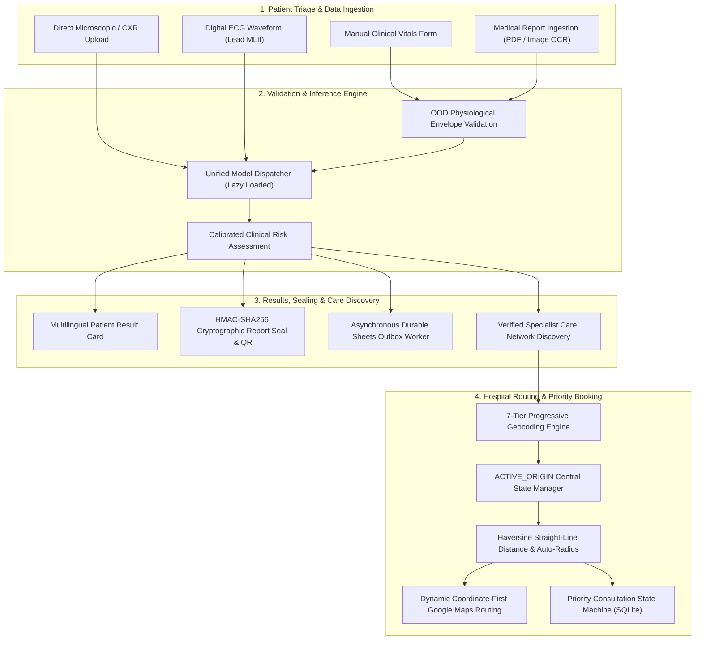
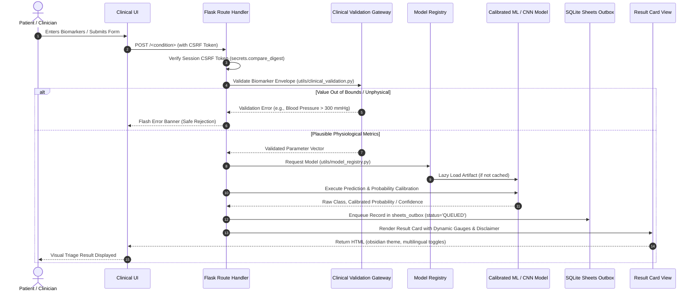
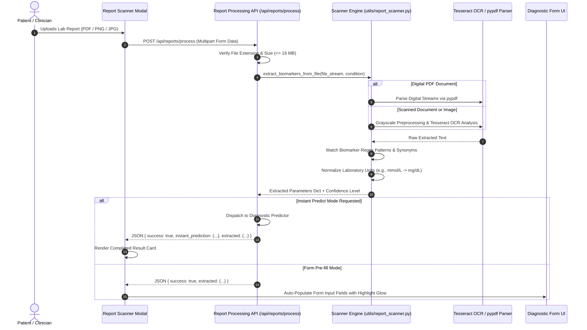
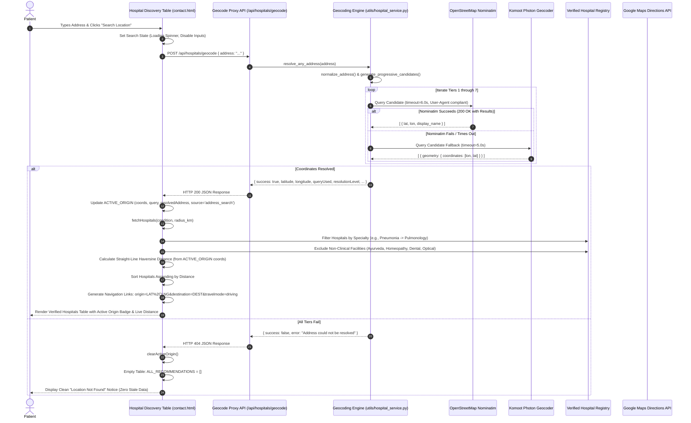
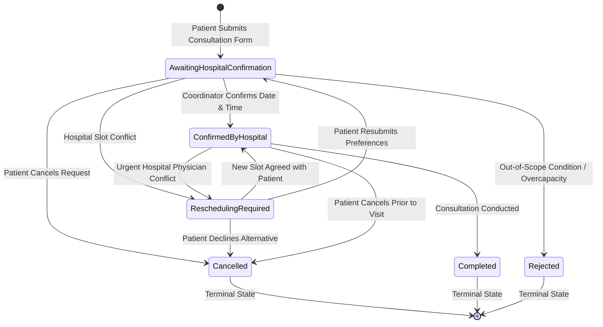
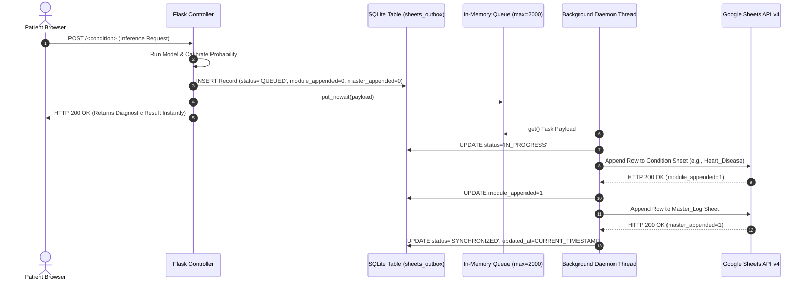
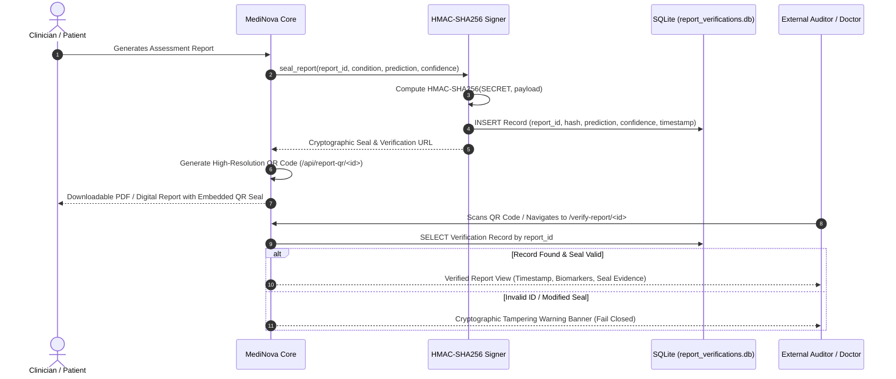
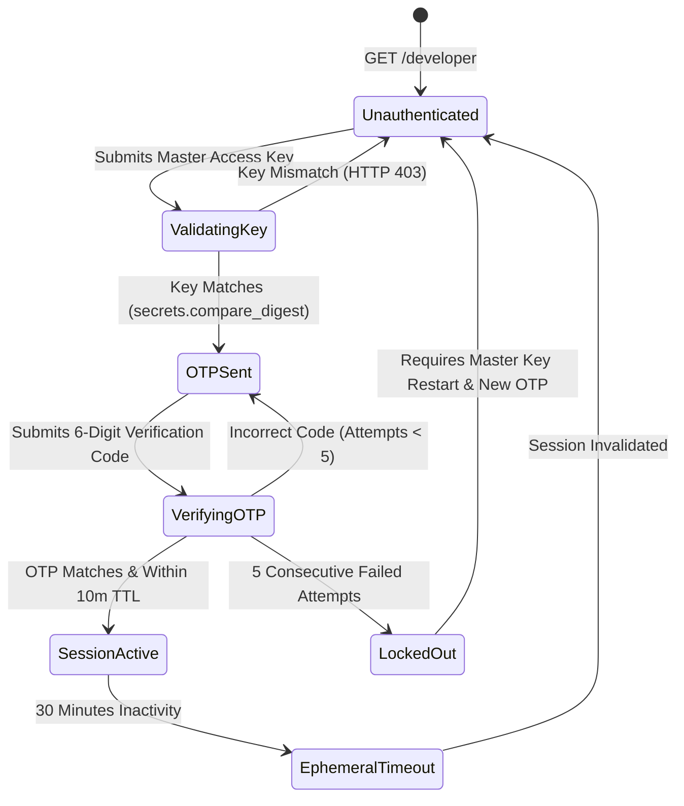

# MediNova End-to-End Operational Workflows & Lifecycle Specification

**Version:** 5.0.0 (Next-Generation Clinical Decision Support & Location Intelligence Edition)  
**Classification:** AI-Assisted Clinical Decision Support Suite (CDSS) & Healthcare Discovery Engine  
**Architect & Maintainer:** DHARSAN KUMAR R  
**Audited & Validated:** October 2026  

---

## 🌟 Executive Workflow Overview

This document specifies the operational lifecycle, data contracts, and control flows governing MediNova. Every workflow is architected for strict clinical safety, defensive fail-closed execution, resource efficiency ($\le 512\,\text{MB}$ container memory), zero patient data leakage, and high reliability across edge conditions.



---

## 📋 Comprehensive Workflow Index

1. [Workflow 1: Patient Clinical Screening & Diagnostic Triage](#workflow-1-patient-clinical-screening--diagnostic-triage)
2. [Workflow 2: Medical Report Ingestion & Multi-Format Scanner Pipeline](#workflow-2-medical-report-ingestion--multi-format-scanner-pipeline)
3. [Workflow 3: Unified 7-Tier Progressive Geocoding & Hospital Discovery](#workflow-3-unified-7-tier-progressive-geocoding--hospital-discovery)
4. [Workflow 4: Client-Side Location Management & ACTIVE_ORIGIN State Machine](#workflow-4-client-side-location-management--active_origin-state-machine)
5. [Workflow 5: Priority Consultation Lifecycle & State Transitions](#workflow-5-priority-consultation-lifecycle--state-transitions)
6. [Workflow 6: Asynchronous Google Sheets Outbox Logging](#workflow-6-asynchronous-google-sheets-outbox-logging)
7. [Workflow 7: Cryptographic Report Authentication & Verification](#workflow-7-cryptographic-report-authentication--verification)
8. [Workflow 8: Developer Portal & 2FA Security Governance](#workflow-8-developer-portal--2fa-security-governance)

---

## Workflow 1: Patient Clinical Screening & Diagnostic Triage

### Objective
Enable patients and clinicians to submit multi-parametric biomarkers or physiological data, validate clinical plausibility, perform calibrated machine learning inference, and deliver multi-lingual risk stratifications.

### Sequence Diagram


### Key Safety Invariants
1. **Zero Hardcoded Confidence Fallbacks:** Discrete categorical models explicitly return `confidence_score = None`, rendered as *"Not Stated (Categorical Assessment)"* without fabricated 95% figures.
2. **Physiological Envelope Gating:** Extreme values (e.g., negative age, blood pressure > 350, glucose > 1200) trigger fail-safe rejection before hitting model matrices.
3. **Emergency Red-Flag Escalation:** Extreme indicators (e.g., resting BP > 180, severe ST depression, troponin elevation) trigger emergency alert banners with instant telephone hotline dialing (`112 / 911 / 108`).

---

## Workflow 2: Medical Report Ingestion & Multi-Format Scanner Pipeline

### Objective
Convert unstructured laboratory reports (digital PDFs or photographed paperwork) into validated structured parameters and optionally trigger immediate zero-click diagnostic inference.

### Sequence Diagram


### Supported Biomarker Normalizations
- **Glucose / Blood Sugar:** $\text{mmol/L} \times 18.0182 \to \text{mg/dL}$
- **Serum Creatinine:** $\mu\text{mol/L} \div 88.42 \to \text{mg/dL}$
- **Total Bilirubin:** $\mu\text{mol/L} \div 17.1 \to \text{mg/dL}$
- **Cholesterol:** $\text{mmol/L} \times 38.67 \to \text{mg/dL}$
- **Hemoglobin:** $\text{mmol/L} \times 1.6114 \to \text{g/dL}$

---

## Workflow 3: Unified 7-Tier Progressive Geocoding & Hospital Discovery

### Objective
Ensure 100% resilient address resolution across noisy Indian road naming conventions (e.g., `Saveetha Engineering College, Saveetha Nagar, (NH-4), Sriperumbudur Taluk, Kanchipuram District, Chennai, Tamil Nadu, 602105`), match disease-specific medical specialties, enforce non-clinical exclusion rules, compute exact straight-line Haversine distances, and construct coordinate-first Google Maps navigation URLs.

### Address Decomposition & Fallback Hierarchy
```
Input Address: "Saveetha Engineering College, Saveetha Nagar, (NH-4), Sriperumbudur Taluk, Kanchipuram District, Chennai, Tamil Nadu, 602105"
                                      │
                                      ▼
                      [Tier 0: normalize_address()]
              Strip plus-codes, normalize Unicode dashes,
             clean highway parentheticals "(NH-4)" -> "NH-4",
                     remove duplicate commas/spaces
                                      │
                                      ▼
                      [Tier 1: Exact Normalized Query]
     "Saveetha Engineering College, Saveetha Nagar, NH-4, Sriperumbudur Taluk, ..."
                                      │ (If 404 / empty)
                                      ▼
                      [Tier 2: Country-Biased Query]
         "Saveetha Engineering College, Saveetha Nagar, NH-4, ..., India"
                                      │ (If 404 / empty)
                                      ▼
                  [Tier 3: Locality Without Road Noise]
        "Saveetha Nagar, Sriperumbudur Taluk, Kanchipuram District, Chennai, TN"
                                      │ (If 404 / empty)
                                      ▼
               [Tier 4: Locality + District/Town + State]
               "Saveetha Nagar, Sriperumbudur, Tamil Nadu"
                                      │ (If 404 / empty)
                                      ▼
                    [Tier 5: District/Town + State]
                     "Sriperumbudur, Tamil Nadu"
                                      │ (If 404 / empty)
                                      ▼
                       [Tier 6: 6-Digit Indian PIN]
                             "602105, India"
                                      │ (If 404 / empty)
                                      ▼
                 [Tier 7: Approximate Major City Center]
         "Chennai, Tamil Nadu" (Explicitly flagged: approximateCityCenter=true)
```

### Complete Hospital Discovery Flow


---

## Workflow 4: Client-Side Location Management & ACTIVE_ORIGIN State Machine

### Objective
Provide a unified, single source of truth for the patient's geographic origin in `templates/contact.html`, eliminating race conditions between manual text input, browser GPS geolocation, and quick-metro city buttons.

### Centralized State Schema (`ACTIVE_ORIGIN`)
```javascript
let ACTIVE_ORIGIN = {
    userOriginCoords: null,            // [lat, lng] or null
    userOriginAddress: '',             // Raw user input or button label
    userOriginResolvedAddress: '',     // Canonical geocoded address string
    userOriginSource: 'none',          // 'browser_geolocation' | 'address_search' | 'metro_quick_button' | 'approximate_city_center'
    userOriginPrecision: 'unresolved'  // 'gps_exact' | 'geocoded_high' | 'geocoded_locality' | 'geocoded_pincode' | 'city_approximate'
};
```

### Transition Matrix
| Trigger Action | Input Data | Target Origin Coordinates | Target Source | Target Precision | Recommendations Action |
| :--- | :--- | :--- | :--- | :--- | :--- |
| **Browser GPS** | `navigator.geolocation.getCurrentPosition` | `[coords.latitude, coords.longitude]` | `'browser_geolocation'` | `'gps_exact'` | Re-sort & render with exact distances |
| **Manual Search (Exact)** | Text Address string | Geocoded `[res.latitude, res.longitude]` | `'address_search'` | `'geocoded_high'` | Re-sort & render from resolved coordinates |
| **Manual Search (PIN)** | 6-Digit PIN Code | Geocoded `[res.latitude, res.longitude]` | `'address_search'` | `'geocoded_pincode'` | Re-sort & render from centroid |
| **Quick Metro Button** | Chennai, Delhi, Mumbai, etc. | Preset Metro Coordinates | `'metro_quick_button'` | `'geocoded_high'` | Populate address field, re-sort & render |
| **Lookup Failure** | Unresolvable gibberish | `null` | `'none'` | `'unresolved'` | **`clearActiveOrigin()`**: Clear table, set `ALL_RECOMMENDATIONS = []`, display error banner |

---

## Workflow 5: Priority Consultation Lifecycle & State Transitions

### Objective
Govern patient appointment requests through an auditable, persistent state machine in SQLite (`medinova_appointments.db`), enforcing authorization boundaries, patient privacy, and notification triggers.

### State Transition Diagram


### Lifecycle Invariants
1. **Cryptographic Reference ID:** Every appointment is assigned an indexed, collision-resistant identifier formatted as `APT-YYYY-XXXXXX` (e.g., `APT-2026-B8E19F`).
2. **Dual-Factor Record Isolation:** Accessing appointment details or tracking status requires both the Reference ID and the exact matching patient phone number or email address.
3. **Digital Calendar Export:** Confirmed appointments generate standard RFC 5545 `.ics` downloadable files and dynamic 1-click Google Calendar web scheduling URLs.
4. **Terminal State Immutability:** Appointments in `Completed`, `Cancelled`, or `Rejected` states cannot transition back to active states without supervisor intervention.

---

## Workflow 6: Asynchronous Google Sheets Outbox Logging

### Objective
Ensure durable, zero-latency clinical logging to private Google Sheets worksheets (`Master_Log` and condition-specific sheets) without blocking diagnostic response times or losing records during network drops.

### Architecture & Sequence Flow


### Defensive Reliability Rules
- **Formula Injection Defense:** All string values starting with formula trigger tokens (`=`, `+`, `-`, `@`, `\t`, `\r`) are automatically escaped with a leading single quote (`'`), neutralizing spreadsheet calculation vulnerabilities.
- **Idempotent Retry Guarantee:** If appending to `Master_Log` fails after `Condition_Sheet` succeeds, subsequent retries only push to `Master_Log`, eliminating duplicate rows.
- **Queue Saturation Safety:** If the in-memory queue exceeds its 2,000-item buffer, records are saved directly to `sheets_outbox` with status `QUEUED` for sequential batch pickup.

---

## Workflow 7: Cryptographic Report Authentication & Verification

### Objective
Provide tamper-evident cryptographic sealing for clinical screening reports, enabling public verification via dynamic QR codes and anti-counterfeit audit registries.

### Verification Flow


---

## Workflow 8: Developer Portal & 2FA Security Governance

### Objective
Protect administrative diagnostic controls and sensitive patient records through hardened two-factor authentication (2FA), constant-time key validation, rate-limiting, and zero-leakage logging.

### Developer Authentication State Machine


### Security Guardrails
1. **Zero Console Leaks:** Generated 6-digit OTP codes are dispatched solely via authenticated SMTP to `AUTHORIZED_DEV_EMAIL`. OTP values are strictly excluded from console logs, stdout, error traces, and HTTP responses.
2. **60-Second Cooldown:** Developers cannot request another OTP within 60 seconds of a previous request.
3. **5-Attempt Lockout:** 5 consecutive failed code submissions immediately invalidate the active token and require re-authentication from the master access key.
4. **Constant-Time Comparison:** All secret comparisons use `secrets.compare_digest()` to eliminate timing-attack vulnerabilities.

---

<p align="center">
  <strong>MediNova Clinical Decision Support Suite</strong> • Engineered for Precision, Resilience & Security
</p>
